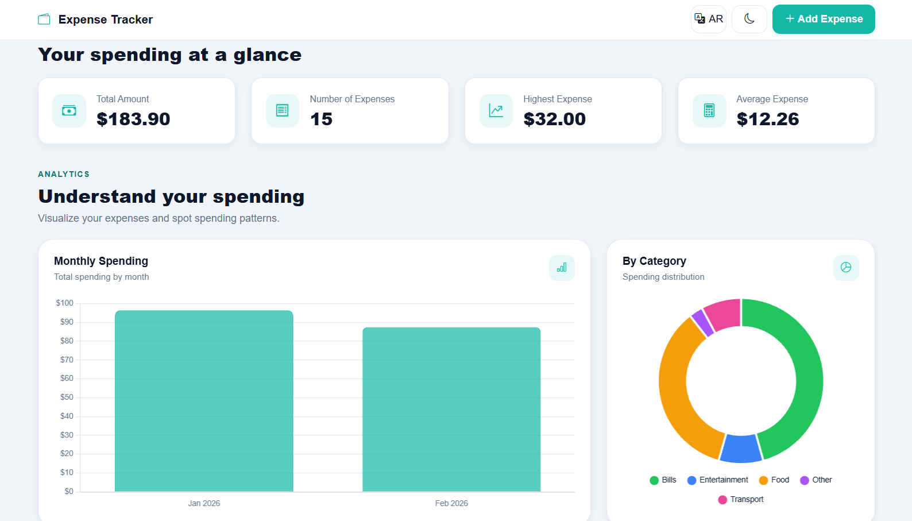
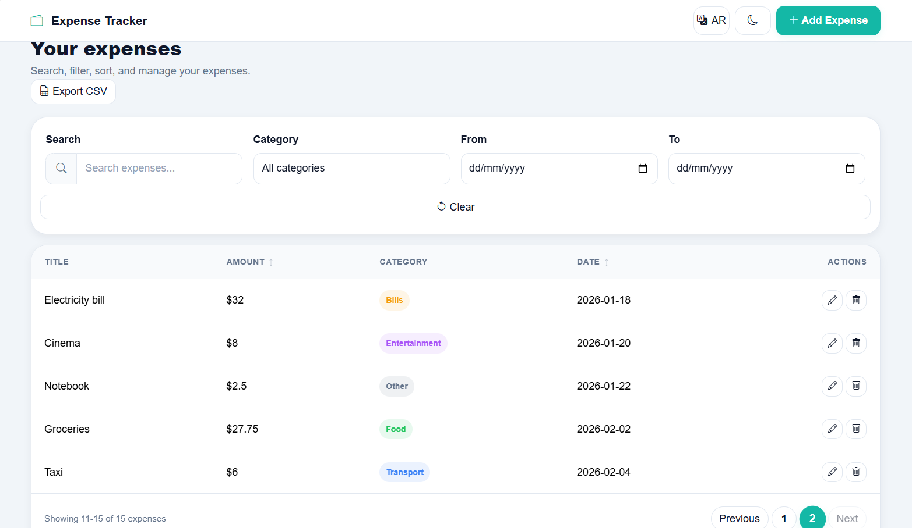
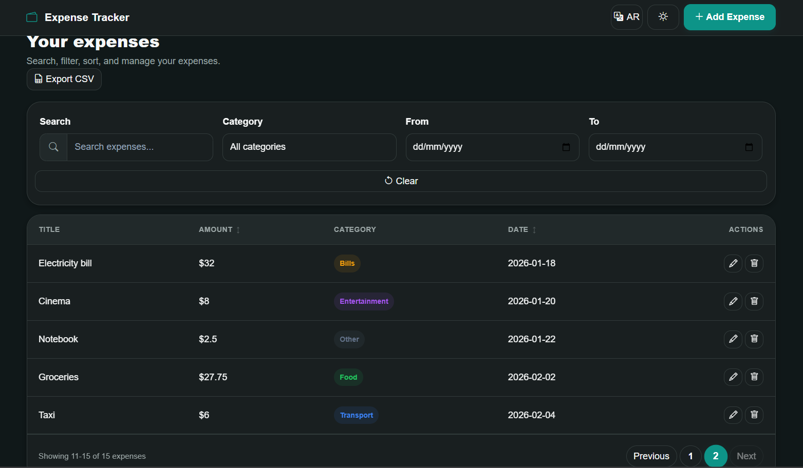
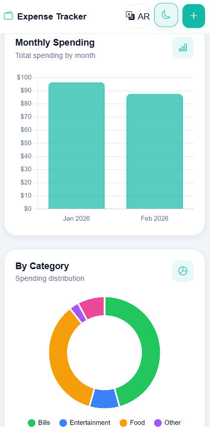
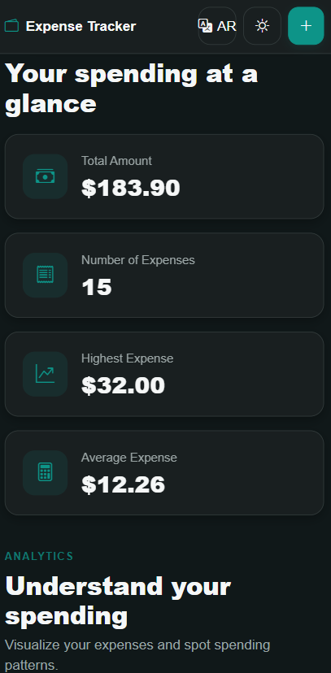

# Expense Tracker

A web application for managing personal expenses. It lets users record and manage expenses, review spending summaries and charts, and organize expense records using search, filters, and sorting.

## How to run

**Backend**

1. Create a PostgreSQL database named `expense_tracker`:
   ```sql
   CREATE DATABASE expense_tracker;
   ```
2. Run the provided `schema.sql` file on the `expense_tracker` database:
   ```bash
   psql -U postgres -d expense_tracker -f schema.sql
   ```
3. In the backend project folder, create a `.env` file and add your PostgreSQL connection settings:
   ```env
   DB_HOST=localhost
   DB_PORT=5432
   DB_NAME=expense_tracker
   DB_USER=postgres
   DB_PASSWORD=your_postgresql_password
   ```
   Replace `your_postgresql_password` with your PostgreSQL password.
4. Open a terminal in the backend folder and install the required packages:
   ```bash
   npm install express cors pg dotenv
   ```
5. Start the backend server:
   ```bash
   node server.js
   ```
   The API will be available at `http://localhost:3000`.

**Frontend**

1. Open the frontend folder.
2. Open `index.html` in your browser.

## Features

- [x] Add new expenses with input validation
- [x] Edit existing expenses
- [x] Delete expenses
- [x] View all expenses in a paginated table
- [x] Search expenses by title
- [x] Filter expenses by category
- [x] Filter expenses by date range
- [x] Sort expenses by amount (ascending and descending)
- [x] Sort expenses by date (ascending and descending)
- [x] View summary cards for total spending, number of expenses, highest expense, and average spending
- [x] View monthly spending chart
- [x] View spending breakdown by category chart
- [x] Export all matching expenses to a CSV file
- [x] Light and dark themes
- [x] English and Arabic language support
- [x] Responsive layout for different screen sizes
- [x] PostgreSQL database integration for persistent expense data
- [x] Loading state, empty state, and error messages
- [x] Success and error notifications


## Screenshots

### Statistics


### Expenses Table - Light Mode


### Expenses Table - Dark Mode


### Mobile - Light Mode


### Mobile - Dark Mode



## What was the hardest part?

In general, almost the whole was a new experience and a new thing to learn. But one of the main challenges was connecting the frontend, backend API, and PostgreSQL database so that expense data could be created, updated, deleted, filtered, and displayed consistently. This was addressed by integrating the frontend with the API and testing the main expense-management features.
